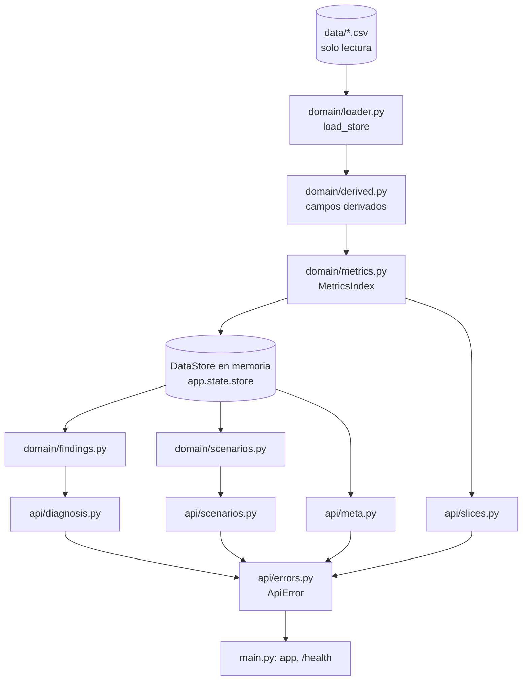
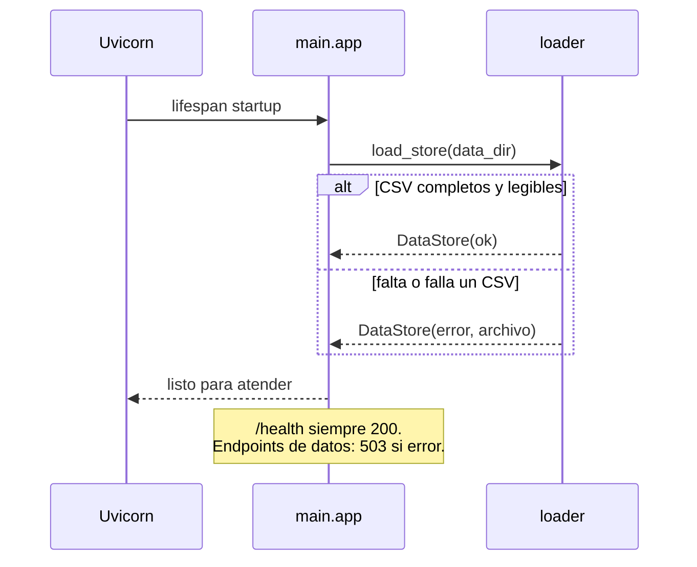

# Documento de Diseño: nfl-trade-bowl-data-api

## Overview

El backend de NFL TRADE BOWL carga `games.csv`, `plays.csv` y `players.csv` una sola vez al arrancar, calcula en memoria los campos derivados por jugada y una tabla de agregados por equipo, perspectiva, dimensión y bucket, y expone cuatro endpoints bajo `/api` más `GET /health`. Todo lo que devuelve la API sale de esos agregados precalculados. Ninguna petición abre archivos ni escribe en disco.

Decisiones principales:

| Decisión | Motivo |
|---|---|
| Precalcular un `MetricsIndex` al arrancar | La muestra es de 8,557 jugadas. El agregado completo (32 equipos × 2 perspectivas × 8 dimensiones) cabe en memoria y evita recalcular por petición. Las respuestas son deterministas. |
| Capa `domain/` pura (sin FastAPI, sin I/O salvo `loader`) | Permite probar la lógica con DataFrames pequeños y generadores aleatorios, sin servidor. |
| `verdict` y `rank` se resuelven en el backend | Lo exige el contrato: el frontend no calcula ni reordena. |
| Un único `Primary_Metric` configurable en una constante | La decisión `playResult` vs `prePenaltyPlayResult` (Tarea 1.2) cambia una línea, no el código de métricas. Valor inicial: `playResult`. |
| Handlers de error propios | Sustituyen el 422 por defecto de FastAPI y garantizan `ApiError` en todo `/api`. |

### Desviaciones y puntos que requieren aprobación

1. **Ubicación del código.** `.kiro/steering/structure.md` dice que la raíz operativa es `hackathon-unam/` y que `hackaton-still-in-nfl/` es un clon antiguo que no se usa para ejecutar. Por decisión del usuario, el backend y `docs/CONTRATO_API.md` viven en `hackaton-still-in-nfl/` (`backend/`, `docs/`). Esto contradice `structure.md`. Hay que actualizar ese archivo steering (o registrar la excepción) en una rama `contract/<cambio>`. El `.venv` sigue en `hackathon-unam/.venv`.
2. **Directorio de datos.** `data/` sigue en `hackathon-unam/data/`, fuera de la carpeta compartida. Se resuelve como se describe en "Resolución del directorio de datos".
3. **Pruebas basadas en propiedades sin librería nueva.** El flujo pide una librería PBT, pero el stack fijo no incluye Hypothesis y no se pueden agregar dependencias (Requisito 9.12). Las propiedades se implementan como pruebas `pytest` parametrizadas con generadores de `numpy.random.default_rng(seed)`, mínimo 100 iteraciones por propiedad y semilla fija. Son generadores de datos, no un framework. Si el equipo aprueba Hypothesis, las propiedades se pasan a ella sin cambiar su enunciado.
4. **Cambios al contrato** (rama `contract/<cambio>`, aprobación de Persona 2): `Meta.dimensions` pasa de `Dimension[]` a `{dimension, buckets[]}[]` (Requisito 4.7); se agregan los códigos `NOT_FOUND` e `INTERNAL_ERROR` a `ApiError`; se documentan los cortes de `fieldZone` y `clockWindow`, la definición de `percentile` y la `Primary_Metric` elegida.

## Architecture



Flujo de arranque (lifespan de FastAPI):



### Estructura de carpetas

```text
hackaton-still-in-nfl/
├── backend/
│   ├── __init__.py
│   ├── main.py            # cargar_env(), app, lifespan, /health, montaje de dist
│   ├── config.py          # constantes: umbrales, PRIMARY_METRIC, resolución de rutas
│   ├── schemas.py         # modelos Pydantic (camelCase)
│   ├── api/
│   │   ├── __init__.py
│   │   ├── deps.py        # get_store() -> DataStore o DataUnavailable
│   │   ├── errors.py      # ApiException, handlers, catch-all /api/{rest}
│   │   ├── meta.py
│   │   ├── teams.py       # slices y diagnosis
│   │   └── scenarios.py
│   ├── domain/
│   │   ├── __init__.py
│   │   ├── loader.py      # lectura de CSV, DataStore
│   │   ├── derived.py     # yardsToEndzone, fieldZone, distanceBucket, clockWindow
│   │   ├── metrics.py     # agregados, ci, mediana, percentil, sampleFlag, verdict
│   │   ├── findings.py    # attention / strengths / explicaciones
│   │   ├── scenarios.py   # vista previa
│   │   └── texts.py       # textos fijos (limits, caveats, disclaimers) y lexicón de Trade_Claim
│   └── tests/
├── docs/CONTRATO_API.md
└── .kiro/specs/nfl-trade-bowl-data-api/
```

### Resolución del directorio de datos

`config.resolve_data_dir()` devuelve la primera ruta que exista como directorio, en este orden:

1. Variable de entorno `DATA_DIR` (ruta absoluta o relativa a la raíz del proyecto).
2. `<PROJECT_ROOT>/data`, con `PROJECT_ROOT = Path(__file__).resolve().parent.parent`.
3. `<PROJECT_ROOT>.parent/data` (caso actual: el código está en `hackaton-still-in-nfl/` y los datos en `hackathon-unam/data/`).

Si ninguna existe, devuelve la opción 2 y el loader falla con `DATA_UNAVAILABLE`. Nunca se usa una ruta absoluta fija. `DATA_DIR` se lee con `os.environ.get`, igual que el resto de configuración. Los archivos se abren solo en modo lectura y no se lee `data/tracking/`.

### Servir el dashboard

Si existe `<PROJECT_ROOT>/dashboard/dist` (o, con el mismo fallback, `<PROJECT_ROOT>.parent/dashboard/dist`), `main.py` lo monta en `/` con `StaticFiles(html=True)` después de registrar los routers y el catch-all `/api/{rest:path}`. Si no existe, no se monta nada y la API funciona igual. Así el contrato de despliegue (un puerto, API y build en la misma URL) se respeta sin crear la carpeta en este directorio.

## Components and Interfaces

### `main.py`

- Define `cargar_env()` con el código exacto de las reglas del proyecto y lo llama antes de cualquier otro uso de `os.environ` y de boto3. No importa boto3 (la IA no forma parte de esta especificación). No lee `AWS_*`. Si `.env` no existe, no hace nada ni registra advertencias.
- `app = FastAPI(lifespan=lifespan)`. El lifespan llama a `load_store(resolve_data_dir())` y guarda el resultado en `app.state.store`.
- `GET /health` devuelve exactamente `{"status": "ok"}` y no depende del store.
- Importar `backend.main` no carga datos (la carga ocurre en el lifespan), por lo que `.venv/bin/python -c "import backend.main"` es barato y no falla si faltan CSV.

### `domain/loader.py`

```python
class DataStore(BaseModel-like dataclass):
    status: Literal["ok", "error"]
    failed_file: str | None            # solo nombre, p. ej. "plays.csv"
    games: pd.DataFrame
    plays: pd.DataFrame                # con columnas derivadas
    players: pd.DataFrame
    index: MetricsIndex | None
    meta: MetaData | None

def load_store(data_dir: Path) -> DataStore
def build_store(games, plays, players) -> DataStore   # sin I/O, usado por las pruebas
```

- `load_store` lee los tres archivos con `pd.read_csv(path)` sin transformar `playResult`, `prePenaltyPlayResult`, `passResult` ni columnas `pff_*`. Si cualquiera falla (no existe, no se puede leer, no es CSV), devuelve `status="error"` con el nombre del primer archivo problemático y no conserva datos parciales. El mensaje de error nunca incluye la ruta.
- `build_store` valida columnas requeridas, une `plays` con `games` por `gameId` (solo para `season` y `week`) y, si se necesita información de jugadores, por `nflId`. Nunca por `playId` solo, `playDescription` ni `displayName`. Si falta una columna requerida, trata el caso como `error` con el nombre del archivo.
- Las tablas se tratan como inmutables tras la carga. Las funciones de dominio no modifican los DataFrames recibidos (usan copias o devuelven columnas nuevas).
- Los valores `NA` de los CSV se leen como nulos con el comportamiento por defecto de pandas. Se verificará al implementar que ninguna etiqueta de `passResult`, `offenseFormation` ni `pff_passCoverageType` se pierda como nula por esa regla; si ocurre, se usa `keep_default_na=False` solo en la columna afectada.

### `domain/derived.py`

Funciones puras escalares (probables con generadores) y una versión vectorizada que las usa como referencia:

```python
def yards_to_endzone(side: str | None, possession: str, number: int) -> int | None
def field_zone(yte: int | None) -> str | None
def distance_bucket(yards_to_go: int) -> str | None
def clock_window(quarter: int, game_clock: str) -> str | None
def add_derived_fields(plays: pd.DataFrame) -> pd.DataFrame
```

Reglas:

- `yards_to_endzone`: `side == possession` → `100 - number`; `side` no vacío y distinto → `number`; `side` vacío y `number == 50` → `50`; `number` fuera de 0 a 50 o no entero → `None`; `side` vacío y `number != 50` → `None`. Resultado siempre en 0..100.
- `field_zone` (cortes propuestos, a documentar en el contrato; enteros, sin huecos ni traslapes sobre 0..100):

| Zona | `yardsToEndzone` |
|---|---|
| `redZone` | 0 a 20 |
| `opponentTerritory` | 21 a 50 |
| `ownTerritory` | 51 a 79 |
| `backedUp` | 80 a 100 |

- `distance_bucket`: `short` (1 a 3), `medium` (4 a 7), `long` (≥ 8); `yardsToGo < 1` o no entero → `None`.
- `clock_window` (ventanas y cortes propuestos, a documentar en el contrato). Se interpreta `gameClock` con `mm:ss` (minutos 0 a 15, segundos 0 a 59); el tiempo restante es `mm*60+ss` segundos.

| Ventana | Condición |
|---|---|
| `early` | `quarter` 1 o 3 |
| `late` | `quarter` 2 o 4 y tiempo restante > 120 s |
| `twoMinute` | `quarter` 2 o 4 y tiempo restante ≤ 120 s |
| `overtime` | `quarter` ≥ 5 |

  Reloj no interpretable o `quarter` fuera de 1 a 5 → `None`. Se asume que `early` no depende del reloj; si un reloj no interpretable aparece en Q1/Q3, la ventana sigue siendo `early` solo si se puede interpretar el reloj. Se decide que **toda** ventana exige reloj interpretable, para que el Requisito 2.10 se cumpla de forma uniforme.
- Cada campo derivado depende solo de sus insumos: `yardsToEndzone`/`fieldZone` de `yardlineSide`, `possessionTeam`, `yardlineNumber`; `distanceBucket` de `yardsToGo`; `clockWindow` de `quarter` y `gameClock`. Un dato inválido anula solo los derivados que dependen de él.
- `playAction` es `str(pff_playAction)` y `coverageType` es `pff_passCoverageType` sin recodificar. `down`, `quarter` y `offenseFormation` se toman crudos. Todos los buckets se manejan como `str` (por ejemplo `"3"` para `down`).

### `domain/metrics.py`

```python
class SegmentAgg: n, mean, std, explosive_rate, negative_rate

def sample_flag(n: int) -> SampleFlag               # <20 hidden, 20-49 low, >=50 ok
def compute_ci(mean: float, std: float | None, n: int) -> tuple[float, float]
def verdict(perspective, ci_low, ci_high, league_median) -> Verdict
def percentile(value: float, eligible: np.ndarray) -> float
class MetricsIndex:
    def slice_table(team, perspective, dimension) -> list[SliceMetric]        # sin hidden
    def slice_for(team, perspective, dimension, bucket) -> SliceMetric | None # incluye hidden
    def summary(team, perspective) -> SummaryMetric
    def all_slices(team, perspective) -> list[SliceMetric]                    # para hallazgos
    def team_slices_for_bucket(perspective, dimension, bucket) -> dict[str, SliceMetric]
    def outcome_mix(team, perspective) -> list[OutcomeShare]
```

Construcción (`build_index(plays)`): para cada perspectiva (`offense` agrupa por `possessionTeam`, `defense` por `defensiveTeam`) y dimensión, se descartan jugadas con `Primary_Metric` nula o con bucket nulo, y se hace un `groupby([team, bucket])` con `n`, media, desviación muestral (`ddof=1`), conteo de `>= explosiveYards` y conteo de `< 0`. Luego, por `(perspective, dimension, bucket)` se calculan `leagueMedian` y `percentile` sobre los equipos con `n >= minDisplay`.

Definiciones:

- `ci = mean ± 1.96·std/√n`; con `n == 1`, `low = high = mean`.
- `leagueMedian = np.median` de `avgPlayResult` de los equipos con `n >= 20` en el mismo bucket y perspectiva. Si no hay ninguno, `leagueMedian`, `diff` y `percentile` son `None` y `verdict = inconclusive`.
- `percentile(x, eligible) = 100·(#{e < x} + 0.5·#{e == x}) / len(eligible)`. Es el percentil de rango sobre `avgPlayResult`, con 0..100 y sin invertir en defensa (más yardas permitidas = percentil más alto). El sentido favorable lo expresa `verdict`. Esta definición se documenta en el contrato.
- `verdict` ofensiva: `favorable` si `ci.low > median`; `adverse` si `ci.high < median`; si no, `inconclusive`. Defensiva: `favorable` si `ci.high < median`; `adverse` si `ci.low > median`; si no, `inconclusive`.
- `SliceMetric.leagueMedian`, `diff` y `percentile` son opcionales (`float | None`) en el esquema Python. El contrato TypeScript declara `number`, por lo que el cambio a `number | null` entra en la rama `contract/<cambio>`.
- `outcome_mix`: sobre jugadas del equipo en la perspectiva con `passResult` no nulo; `share = count/total`, `n = total`; `leagueMedian` es la mediana, sobre los equipos con total ≥ `minDisplay`, de la proporción de esa etiqueta (0 si el equipo no la tiene). Las etiquetas son las observadas en la liga, tal cual.
- `summary` usa todas las jugadas del equipo con `Primary_Metric` no nula en la perspectiva, y `leagueMedian` y `percentile` entre los 32 equipos.

### `domain/findings.py`

```python
def select_findings(slices: list[SliceMetric]) -> tuple[list[Finding], list[Finding]]
def explain(slice: SliceMetric, perspective) -> str
def build_diagnosis(store, team, perspective) -> Diagnosis
```

- Candidatos: segmentos de todas las dimensiones con `sampleFlag == ok`. `attention` toma `verdict == adverse`, `strengths` toma `verdict == favorable`.
- Orden por `abs(diff)` descendente; empate por nombre de segmento ascendente, donde el nombre es `f"{dimension}={bucket}"`. Se toman los 3 primeros y se asigna `rank` 1..k.
- `explanation` usa una plantilla: `"Tendencia observada en la muestra 2021 (semanas 1 a 8): {segmento}, n={n}, {avg:.2f} yardas por jugada frente a una mediana de liga de {median:.2f}."` Nunca incluye "debilidad confirmada", "conversión oficial" ni "equipo actual".
- Si una lista queda vacía, se agrega a `caveats` un texto que nombra la lista vacía (`attention` o `strengths`), con respuesta 200.
- `caveats` siempre incluye el texto de muestra (2021, semanas 1 a 8; `plays.csv` no documentado como universo completo) y, si `PRIMARY_METRIC == "playResult"`, el texto de que incluye yardas de falta.

### `domain/scenarios.py`

```python
def preview(store, req: ScenarioRequest) -> ScenarioPreview
```

Orden de validación: equipo y `partnerTeam` (404) → valores de enums y `bucket` de `need` (422 `INVALID_PARAMETER`) → `futureAssetNote` > 280 (422) → `targetPosition` fuera de `Meta.positions` (422) → `sampleFlag` de la necesidad distinto de `ok` (422 `INSUFFICIENT_SAMPLE`). Solo después se calcula.

- `evidence = [slice_for(team, need.perspective, need.dimension, need.bucket)]`. Nunca lee `strategy`, `manualRecord`, `futureAssetNote`, `partnerTeam` ni `targetPosition`.
- `partnerProfiles` computados: de `team_slices_for_bucket(need.perspective, need.dimension, need.bucket)` se toman los otros equipos con `verdict == favorable` y `sampleFlag == ok`, orden por `abs(diff)` descendente y desempate por abreviatura ascendente, máximo 5, `source = "computed"`. La "fortaleza relacionada" es el mismo segmento (misma dimensión, bucket y perspectiva) en el que otro equipo es favorable.
- Si hay `partnerTeam`, se agrega un perfil `source = "manual"` con el segmento de ese equipo para la necesidad (aunque no sea favorable), sin contar para el máximo de 5. Si ese equipo no tiene segmento visible, el perfil manual lleva `slice` con `sampleFlag` según corresponda; si `hidden`, se omite el perfil y se agrega un aviso en `disclaimers`.
- Cada `PartnerProfile.note` es exactamente `"perfil histórico 2021; no implica interés ni disponibilidad"`.
- `assumptions`: un elemento por dato manual informado (`strategy`, `manualRecord`, `futureAssetNote`, `partnerTeam`, `targetPosition`), cada uno con el rótulo exacto `"dato manual, no verificado"` al inicio, por ejemplo `"dato manual, no verificado: estrategia = compete"`.
- `missingData` fijo: `["contratos", "roster", "cap", "agentes libres", "picks", "valor de mercado"]`.
- `disclaimers` incluye que el escenario es hipotético, que no recomienda transacciones reales y, si no hay perfiles computados, que no se encontraron perfiles computados.
- La función no escribe ni muta nada, así que dos llamadas idénticas dan respuestas iguales.

### `domain/texts.py`

Concentra todos los textos fijos y el lexicón de `Trade_Claim`. El lexicón es una lista de patrones en minúsculas (por ejemplo `disponible para trade`, `está disponible`, `vale `, `valor de mercado de`, `es viable`, `trade justo`, `aceptará`, `aceptaría`, `intercambio justo`, `recomendamos`). Es la fuente para la prueba del Requisito 9.8. Los textos fijos nunca coinciden con el lexicón. La excepción es `missingData`, que menciona "valor de mercado" como dato ausente y no como afirmación; el lexicón usa frases completas de afirmación para no marcar esa lista.

Los textos que repiten entrada del usuario (`assumptions`) se arman con el rótulo fijo más el valor tal cual. El backend no puede garantizar que el texto libre del usuario no contenga una afirmación, así que la prueba del Requisito 7.15 genera entradas manuales sin términos del lexicón, y `futureAssetNote` se limita a 280 caracteres.

### `api/` y errores

| Ruta | Handler | Notas |
|---|---|---|
| `GET /api/meta` | `meta.py` | 503 si el store está en error |
| `GET /api/teams/{abbr}/slices` | `teams.py` | `dimension` y `perspective` requeridos |
| `GET /api/teams/{abbr}/diagnosis` | `teams.py` | `perspective` por defecto `offense` |
| `POST /api/scenarios/preview` | `scenarios.py` | cuerpo `ScenarioRequest` |
| `ANY /api/{rest:path}` | `errors.py` | 404 `NOT_FOUND`; se registra antes del montaje estático |

- `deps.get_store()` lee `app.state.store`; si `status == "error"` lanza `ApiException(503, "DATA_UNAVAILABLE", ...)`. Los parámetros `dimension` y `perspective` se declaran como `str` (no `Literal`) y se validan a mano contra `Meta.dimensions` y `{"offense","defense"}`, para controlar el código y los `details`. `abbr` se valida contra `Meta.teams` (404).
- `ApiException(status, code, message, details)` y `register_handlers(app)`:
  - `ApiException` → `{"error": {"code", "message", "details"}}`.
  - `RequestValidationError` (cuerpos inválidos, tipos erróneos, falta de campos) → 422 `INVALID_PARAMETER` con `details = {"fields": [{"field": nombre, "value": recibido}, ...]}` que lista cada campo inválido o faltante. Un cuerpo no JSON se reporta como campo `body`. Aplica solo a rutas bajo `/api`.
  - `Exception` → 500 `INTERNAL_ERROR`, mensaje genérico en español, sin traza; se registra el error con `logging` sin credenciales. En pruebas se usa `TestClient(app, raise_server_exceptions=False)`.
- `message` va en español, de 1 a 200 caracteres, sin rutas, trazas ni nombres de excepciones. `details` siempre es un objeto (`{}` si no hay datos).
- Códigos y estados: `TEAM_NOT_FOUND` 404, `INVALID_PARAMETER` 422, `INSUFFICIENT_SAMPLE` 422, `DATA_UNAVAILABLE` 503, `NOT_FOUND` 404, `INTERNAL_ERROR` 500.

### `schemas.py`

Un `ApiModel(BaseModel)` base con `model_config = ConfigDict(alias_generator=to_camel, populate_by_name=True)`. Todos los modelos del contrato heredan de él. Los routers usan `response_model_by_alias=True` (valor por defecto de FastAPI) para emitir camelCase. `Dimension`, `Perspective`, `Strategy`, `SampleFlag`, `Verdict` son `Literal`.

## Data Models

```python
class Ci(ApiModel):            low: float; high: float
class SliceMetric(ApiModel):
    dimension: Dimension; bucket: str; n: int
    avg_play_result: float; explosive_rate: float; negative_rate: float
    ci: Ci
    league_median: float | None; diff: float | None; percentile: float | None
    sample_flag: SampleFlag; verdict: Verdict
class Finding(SliceMetric):    rank: int; explanation: str
class OutcomeShare(ApiModel):  label: str; share: float; league_median: float; n: int
class SliceTable(ApiModel):    dimension: Dimension; rows: list[SliceMetric]
class Sample(ApiModel):        plays: int; games: int
class Summary(ApiModel):       avg_play_result: float; league_median: float; percentile: float
class Diagnosis(ApiModel):
    team: str; perspective: Perspective; season: int; sample: Sample; summary: Summary
    attention: list[Finding]; strengths: list[Finding]
    outcome_mix: list[OutcomeShare]; caveats: list[str]
class Weeks(ApiModel):         min: int; max: int
class DimensionBuckets(ApiModel): dimension: Dimension; buckets: list[str]
class Meta(ApiModel):
    season: int; weeks: Weeks; teams: list[str]; positions: list[str]
    dimensions: list[DimensionBuckets]
    thresholds: Thresholds   # minDisplay=20, minFinding=50, explosiveYards=20
    dataset: DatasetCounts   # games, plays, players
    limits: list[str]
class ManualRecord(ApiModel):  season: int; wins: int; losses: int; ties: int | None = None
class Need(ApiModel):          dimension: Dimension; bucket: str; perspective: Perspective
class ScenarioRequest(ApiModel):
    team: str; strategy: Strategy; need: Need
    target_position: str | None = None; partner_team: str | None = None
    manual_record: ManualRecord | None = None; future_asset_note: str | None = None
class PartnerProfile(ApiModel): team: str; slice: SliceMetric; source: Literal["computed","manual"]; note: str
class ScenarioPreview(ApiModel):
    evidence: list[SliceMetric]; partner_profiles: list[PartnerProfile]
    assumptions: list[str]; missing_data: list[str]; disclaimers: list[str]
class ApiErrorBody(ApiModel):  code: str; message: str; details: dict[str, Any]
class ApiError(ApiModel):      error: ApiErrorBody
```

Datos en memoria de `DataStore.plays` (columnas relevantes): `gameId`, `playId`, `possessionTeam`, `defensiveTeam`, `playResult`/`prePenaltyPlayResult`, `passResult`, `down`, `quarter`, `offenseFormation`, `pff_playAction`, `pff_passCoverageType` y los derivados `yardsToEndzone`, `fieldZone`, `distanceBucket`, `clockWindow`, más `primary` (copia de la `Primary_Metric`; nula si la columna elegida es nula).

Valores de `bucket` por dimensión (Requisito 4.7):

| Dimensión | Origen | Valores |
|---|---|---|
| `down` | crudo | `"1"`, `"2"`, `"3"`, `"4"` según los datos |
| `quarter` | crudo | valores observados como texto |
| `distanceBucket` | derivado | `short`, `medium`, `long` |
| `fieldZone` | derivado | `redZone`, `opponentTerritory`, `ownTerritory`, `backedUp` |
| `clockWindow` | derivado | `early`, `late`, `twoMinute`, `overtime` |
| `offenseFormation` | crudo | valores observados |
| `playAction` | crudo | `"0"`, `"1"` |
| `coverageType` | crudo | valores observados de `pff_passCoverageType` |

Las listas de buckets crudos se calculan de los datos al arrancar, ordenadas alfabéticamente. Las derivadas son constantes que `docs/CONTRATO_API.md` repite sin diferencias.

`Meta.limits` incluye al menos un texto por cada uno de estos ocho temas: contratos, roster, cap, agentes libres, picks, equipo de `players.csv` (no hay columna de equipo), equipos especiales y `pffScoutingData.csv` (no existe).

## Correctness Properties

*A property is a characteristic or behavior that should hold true across all valid executions of a system-essentially, a formal statement about what the system should do. Properties serve as the bridge between human-readable specifications and machine-verifiable correctness guarantees.*

Reflexión de redundancia: las propiedades de rango de `yardsToEndzone` (2.12) se fusionan con la regla de cálculo (2.2 a 2.4). Las de `distanceBucket` (2.6 a 2.8, 2.13) forman una sola. Los invariantes de `SliceMetric` (5.19, 5.20) se fusionan en una propiedad. La conservación de buckets crudos (5.18) se absorbe en la propiedad del loader (1.8). Los criterios 6.17 (defensa) y 5.15 se resuelven en una sola propiedad de `verdict`. La independencia de `Manual_Input` (7.2, 7.7, 7.8, 9.9) es una propiedad. Se descartaron los criterios de proceso y de configuración (1.9, 1.10, 3.4, 9.x), que son pruebas de humo o ejemplos.

### Property 1: Preservación de valores crudos al cargar

*For any* `plays.csv` generado con etiquetas de `passResult`, columnas `pff_*` y valores de `playResult`/`prePenaltyPlayResult` (incluidos vacíos), cargar el archivo conserva cada valor sin recodificar ni eliminar filas, y los buckets de dimensiones crudas del resultado son iguales a los valores del CSV.

**Validates: Requirements 1.8, 5.18**

### Property 2: yardsToEndzone sigue la regla de lado del campo y queda en 0..100

*For any* `yardlineSide`, `possessionTeam` y `yardlineNumber` entero entre 0 y 50, `yards_to_endzone` devuelve `100 - number` si el lado es la posesión, `number` si el lado es no vacío y distinto, `50` si el lado es vacío y `number == 50`, `None` en otro caso; y cuando devuelve un valor, este está entre 0 y 100.

**Validates: Requirements 2.2, 2.3, 2.4, 2.12**

### Property 3: fieldZone es una partición de 0..100

*For any* entero `yardsToEndzone` entre 0 y 100, `field_zone` devuelve exactamente una de las cuatro zonas documentadas, y el conjunto de enteros de cada zona coincide con sus cortes.

**Validates: Requirements 2.5**

### Property 4: distanceBucket es total y coincide con los cortes

*For any* entero `yardsToGo >= 1`, `distance_bucket` devuelve exactamente un valor: `short` si es ≤ 3, `medium` si está entre 4 y 7, `long` si es ≥ 8.

**Validates: Requirements 2.6, 2.7, 2.8, 2.13**

### Property 5: clockWindow asigna exactamente una ventana a entradas válidas

*For any* `quarter` entre 1 y 5 y `gameClock` con minutos 0 a 15 y segundos 0 a 59, `clock_window` devuelve exactamente una de las cuatro ventanas, y es `twoMinute` si y solo si `quarter` es 2 o 4 y el tiempo restante es ≤ 120 segundos.

**Validates: Requirements 2.9**

### Property 6: Un dato inválido anula solo los derivados que dependen de él

*For any* jugada válida y cualquier insumo corrompido (`gameClock`, `yardlineNumber` o `yardsToGo`), `add_derived_fields` deja nulos exactamente los derivados que dependen de ese insumo, conserva la fila y mantiene sin cambios los demás derivados.

**Validates: Requirements 2.10**

### Property 7: sampleFlag coincide con los umbrales

*For any* entero `n >= 0`, `sample_flag(n)` es `hidden` si `n < 20`, `low` si `20 <= n <= 49` y `ok` si `n >= 50`.

**Validates: Requirements 5.11, 5.12, 5.13**

### Property 8: Las métricas coinciden con un cálculo independiente en numpy

*For any* conjunto de jugadas generado con varios equipos, buckets y valores de la `Primary_Metric` (incluidos nulos), para cada `SliceMetric` el valor de `n`, `avgPlayResult`, `explosiveRate`, `negativeRate`, `ci`, `leagueMedian` y `diff` es igual (tolerancia 1e-9) al calculado de forma independiente con numpy sobre las jugadas con `Primary_Metric` no nula, usando `ddof=1`, la mediana solo entre equipos con `n >= 20` y `ci = media ± 1.96·EE` (con `n == 1`, `low = high = media`); si ningún equipo es elegible, `leagueMedian`, `diff` y `percentile` son nulos y `verdict` es `inconclusive`.

**Validates: Requirements 3.2, 3.5, 3.6, 5.3, 5.4, 5.5, 5.6, 5.7, 5.8, 5.9, 6.12**

### Property 9: Invariantes de SliceMetric

*For any* `SliceMetric` devuelta por `slice_table`, se cumple `ci.low <= avgPlayResult <= ci.high`, `0 <= explosiveRate <= 1`, `0 <= negativeRate <= 1`, `sampleFlag != hidden`, y si `leagueMedian` no es nulo, `diff == avgPlayResult - leagueMedian` con tolerancia 1e-9.

**Validates: Requirements 5.1, 5.11, 5.19, 5.20**

### Property 10: percentile está en 0..100 y es monótono

*For any* conjunto de equipos elegibles en un bucket y perspectiva, cada `percentile` calculado está entre 0 y 100 inclusive, y si el equipo A tiene `avgPlayResult` mayor o igual que el de B, entonces `percentile(A) >= percentile(B)`.

**Validates: Requirements 5.10**

### Property 11: verdict compara el intervalo con la mediana según la perspectiva

*For any* intervalo `[low, high]` con `low <= high`, cualquier mediana de liga y cualquier perspectiva, `verdict` es `favorable` en ataque si `low > mediana` y en defensa si `high < mediana`; `adverse` en ataque si `high < mediana` y en defensa si `low > mediana`; `inconclusive` si `low <= mediana <= high`. Intercambiar la perspectiva intercambia `favorable` y `adverse`.

**Validates: Requirements 5.14, 5.15, 5.16, 6.17**

### Property 12: Conservación de n por equipo, perspectiva y dimensión

*For any* conjunto de jugadas, equipo, perspectiva y dimensión, la suma de `n` de todos los buckets (antes de ocultar los `hidden`) es igual al número de jugadas del equipo con `Primary_Metric` no nula y valor no nulo en esa dimensión.

**Validates: Requirements 5.21**

### Property 13: Los hallazgos respetan los criterios de selección y orden

*For any* lista de `SliceMetric` candidatas, `select_findings` devuelve `attention` y `strengths` con como máximo 3 elementos cada uno; todos con `sampleFlag == ok`; `attention` solo con `verdict == adverse` y `strengths` solo con `favorable`; ordenados por `abs(diff)` descendente con desempate por nombre de segmento ascendente; con `rank` consecutivo desde 1; y sin ningún segmento en ambas listas.

**Validates: Requirements 6.6, 6.7, 6.8, 6.9, 6.16**

### Property 14: Las explicaciones incluyen n y evitan términos prohibidos

*For any* `Finding` generado, `explanation` contiene el valor de `n`, contiene la expresión "tendencia observada" y no contiene "debilidad confirmada", "conversión oficial" ni "equipo actual".

**Validates: Requirements 6.10**

### Property 15: outcomeMix suma 1

*For any* conjunto de jugadas con `passResult` aleatorio para un equipo con al menos una jugada con `passResult`, la suma de `share` de `outcomeMix` es 1 con tolerancia 0.001 y cada `share` está entre 0 y 1.

**Validates: Requirements 6.13**

### Property 16: La evidencia y los perfiles computados no dependen de Manual_Input

*For any* par de `ScenarioRequest` que difieren solo en `strategy`, `manualRecord`, `futureAssetNote`, `partnerTeam` o `targetPosition`, `evidence` y los `partnerProfiles` con `source == computed` son idénticos campo por campo, y cada elemento de `assumptions` empieza con "dato manual, no verificado".

**Validates: Requirements 7.2, 7.7, 7.8, 9.9**

### Property 17: Los perfiles computados cumplen sus condiciones

*For any* dataset generado y `ScenarioRequest` válido, los perfiles `computed` son a lo sumo 5, pertenecen a equipos distintos del solicitante, tienen `verdict == favorable` y `sampleFlag == ok`, están ordenados de forma determinista, y llevan la nota exacta; un `partnerTeam` informado añade exactamente un perfil `manual` sin reducir los computados.

**Validates: Requirements 7.3, 7.5, 7.6**

### Property 18: La vista previa es idempotente y no muta los datos

*For any* `ScenarioRequest` válido, dos llamadas consecutivas devuelven respuestas iguales y los DataFrames y el índice del store son iguales antes y después.

**Validates: Requirements 7.14**

### Property 19: Ningún texto devuelto contiene una Trade_Claim

*For any* equipo, perspectiva, dimensión y `ScenarioRequest` válido con texto manual sin términos del lexicón, todos los textos de `explanation`, `note`, `assumptions`, `missingData`, `disclaimers`, `caveats` y `limits` no coinciden con ningún patrón del lexicón de `Trade_Claim`.

**Validates: Requirements 6.10, 7.15, 9.8**

### Property 20: Toda respuesta de error en /api tiene la forma ApiError

*For any* petición inválida bajo `/api` (equipo inexistente, parámetro fuera de rango, cuerpo con campos faltantes o con tipos erróneos, ruta inexistente, estado de datos no disponibles), la respuesta tiene el estado HTTP asignado a su código, un cuerpo `{error: {code, message, details}}` con `code` no vacío, `message` de 1 a 200 caracteres sin rutas ni trazas, `details` objeto, y `details` incluye el nombre del campo inválido y el valor recibido cuando el error es de parámetro o equipo.

**Validates: Requirements 8.1, 8.2, 8.3, 8.4, 8.5, 8.6, 8.7, 8.9, 5.2, 6.2, 6.3**

### Property 21: Meta lista equipos y posiciones sin duplicados y ordenadas

*For any* conjunto de jugadas y jugadores generado, `Meta.teams` y `Meta.positions` no tienen duplicados ni valores vacíos o nulos, están ordenadas de forma ascendente, `teams` contiene exactamente la unión de `possessionTeam` y `defensiveTeam`, y `positions` conserva el texto original de `officialPosition`.

**Validates: Requirements 4.4, 4.5**

### Property 22: La serialización camelCase es reversible

*For any* modelo de respuesta generado, `model_dump(by_alias=True)` produce solo claves camelCase y `model_validate` sobre ese resultado devuelve un modelo igual al original.

**Validates: Requirements 5.17**

## Error Handling

| Situación | Estado | Código | Comportamiento |
|---|---|---|---|
| CSV faltante, ilegible o con columnas requeridas ausentes | 503 | `DATA_UNAVAILABLE` | Arranque completo, `/health` sigue en 200, mensaje con el nombre del archivo sin ruta, sin carga parcial |
| `{abbr}` fuera de `Meta.teams` | 404 | `TEAM_NOT_FOUND` | `details = {"abbr": valor}` |
| `team` o `partnerTeam` del cuerpo fuera de `Meta.teams` | 404 | `TEAM_NOT_FOUND` | `details = {"field": nombre, "value": valor}` |
| `dimension`, `perspective`, `strategy` o `bucket` fuera de lo permitido; `dimension` ausente | 422 | `INVALID_PARAMETER` | `details = {"field": nombre, "value": valor}`; mensaje con los valores permitidos |
| Cuerpo no JSON, campo faltante o con tipo erróneo | 422 | `INVALID_PARAMETER` | `details.fields` lista cada campo |
| `futureAssetNote` > 280 caracteres; `targetPosition` fuera de `Meta.positions` | 422 | `INVALID_PARAMETER` | Sin calcular el escenario |
| Necesidad con `sampleFlag != ok` | 422 | `INSUFFICIENT_SAMPLE` | Sin calcular el escenario |
| Ruta `/api/...` inexistente | 404 | `NOT_FOUND` | Por el catch-all |
| Excepción no controlada | 500 | `INTERNAL_ERROR` | Mensaje genérico, sin traza; el servidor sigue activo |

Notas:

- Una jugada con insumos inválidos no se descarta; solo queda fuera de las dimensiones que usan el campo nulo (Requisito 2.10).
- Las jugadas con `Primary_Metric` nula se excluyen de `n`, media, tasas e intervalo. Su número se reporta en la prueba de la Tarea 1.2.
- Un segmento oculto (`n < 20`) no aparece en `slices`; si el usuario lo pide como necesidad, la respuesta es `INSUFFICIENT_SAMPLE`. Si el bucket no existe en la dimensión, es `INVALID_PARAMETER`.
- Los mensajes de error no contienen rutas, nombres de excepciones ni credenciales. El backend no lee ni exige `AWS_*`.

## Testing Strategy

Se aplica un enfoque dual: pruebas de ejemplo para estructura, errores y bordes, y pruebas de propiedades para la lógica de negocio. No se aplican propiedades a CRUD, a configuración ni a la lectura de archivos.

**Herramientas:** `pytest 8.3.5`, `httpx 0.28.1` con `fastapi.testclient.TestClient`, `numpy`/`pandas` ya instalados. No se agregan dependencias. Se ejecuta con `.venv/bin/python -m pytest`, desde `hackaton-still-in-nfl/` con `DATA_DIR` apuntando a datos de prueba cuando haga falta.

**Pruebas de propiedades:**

- Cada propiedad de la sección anterior se implementa con **una sola** prueba `pytest` parametrizada por semilla (`@pytest.mark.parametrize("seed", range(100))`, es decir, mínimo 100 iteraciones) y generadores propios con `numpy.random.default_rng(seed)`. Los generadores viven en `backend/tests/generators.py`.
- Cada prueba lleva un comentario con la etiqueta: `# Feature: nfl-trade-bowl-data-api, Property N: <texto de la propiedad>`.
- Los generadores producen jugadas con equipos de un conjunto de 32 abreviaturas, buckets con tamaños que cruzan los umbrales 0, 19, 20, 49 y 50, `Primary_Metric` con nulos y valores negativos y mayores a 20, y casos extremos (un solo equipo elegible, ninguno elegible, `n == 1`).
- Las pruebas de métricas usan `build_store(games, plays, players)` sobre DataFrames generados. La referencia independiente (Property 8) está en la propia prueba, con `np.mean`, `np.std(ddof=1)` y `np.median` sobre filtros de pandas, sin reutilizar código del backend.
- Las propiedades de la API (16 a 20) usan `TestClient` con un store inyectado en `app.state.store`; el escenario con 3 o más valores de `Manual_Input` (Requisito 9.9) es una instancia de la Property 16.

**Pruebas de ejemplo (unitarias e integración):**

- Cortes de `fieldZone`, `clockWindow`, `distanceBucket` en cada frontera y un caso por valor de salida; `yardlineSide` vacío con 50 (Requisitos 9.1 y 9.2); `sample_flag` en 0, 19, 20, 49 y 50 (9.3); `verdict` favorable y adverso por lado (9.4); máximo 3 hallazgos con más de 3 candidatos (9.6).
- Mediana de liga contra numpy sobre al menos 5 equipos fijos (9.5).
- Un caso por código de error del contrato con `TestClient`, verificando estado y forma `ApiError` (9.7), incluida la excepción forzada (500) con `raise_server_exceptions=False` y la ruta inexistente (404 `NOT_FOUND`).
- `GET /health` responde `{"status": "ok"}` con y sin datos; arranque con `DATA_DIR` sin un CSV responde 503 en datos y 200 en `/health`; el mensaje no contiene rutas absolutas (1.6, 1.7, 1.9).
- Arranque sin `.env` no falla ni registra advertencias (1.11); `cargar_env` se llama antes de leer variables (1.10).
- Meta con dataset fijo: claves exactas, sin nulos, umbrales 20/50/20, `limits` con los 8 temas, y buckets derivados iguales a los de `docs/CONTRATO_API.md` parseado (4.1 a 4.3, 4.6, 4.7).
- Join por `(gameId, playId)` con el mismo `playId` en dos juegos (2.1).
- Prueba de análisis de la Tarea 1.2 sobre los datos reales: para jugadas con `penaltyYards` no nulo, imprime para `playResult` y `prePenaltyPlayResult` el número de jugadas, la media con dos decimales, la diferencia absoluta de medias y las jugadas excluidas por nulos (3.1, 3.6). Se marca para ejecutarse solo si existe `data/`.
- Los archivos de `data/` no cambian: la suite calcula el hash SHA-256 de los tres CSV antes y después de ejecutar las pruebas con datos reales (9.13).
- Cierre de tarea: `.venv/bin/python -m pytest` y `.venv/bin/python -c "import backend.main"`, reportando código de salida y número de pruebas aprobadas y fallidas (9.10, 9.11).
