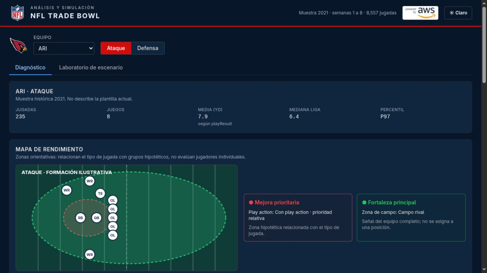

# NFL TRADE BOWL 🏈

### Del dato al tablero. Del tablero a una decisión.

**NFL TRADE BOWL** transforma una muestra histórica de 8,557 jugadas de pase de 2021 en un diagnóstico visual y un laboratorio para explorar decisiones de conformación de equipos. Comparamos las yardas medias de cada segmento con la mediana de equipos que tienen muestra suficiente y mostramos el número de jugadas y un intervalo aproximado. El hallazgo es encontrar trades para la conformación de un equipo en base a las necesidades del equipo, reconstrucción, buscar el SB o competir y al mismo tiempo reconstrucción.

## Hallazgos de la muestra

| Equipo y perspectiva | Segmento observado | Jugadas | Yardas medias | Mediana comparable |
|---|---|---:|---:|---:|
| Carolina · ataque | Terceras oportunidades | 86 | 3.9 | 6.3 |
| Kansas City · defensa | Jugadas rivales con play action | 79 | 10.9 | 8.0 |
| Arizona · ataque | Jugadas en campo rival | 64 | 10.2 | 6.7 |
| Arizona · ataque | Play action · prioridad relativa | 76 | 7.4 | 7.8 |

Las primeras dos filas señalan oportunidades de mejora y la tercera una fortaleza observada; la cuarta es una prioridad relativa **sin evidencia concluyente**, no una debilidad demostrada. Usamos estas señales para alimentar el mapa de rendimiento, elegir una necesidad y comparar socios en un escenario según el récord y la estrategia que introduce el usuario. Las zonas del mapa son ilustrativas y el laboratorio utiliza plantillas, jugadores y selecciones ficticios, por lo que sus porcentajes y propuestas no son probabilidades ni valoraciones de mercado.

**Equipo Still-In:** Miguel Angel Jimenez y Angel Daniel Garcia · NFL Big Data Bowl UNAM

[Guía de uso, datos y ejecución](docs/GUIA_DE_USO.md) · [Contexto del dataset](CONTEXTO_DATOS.md)
