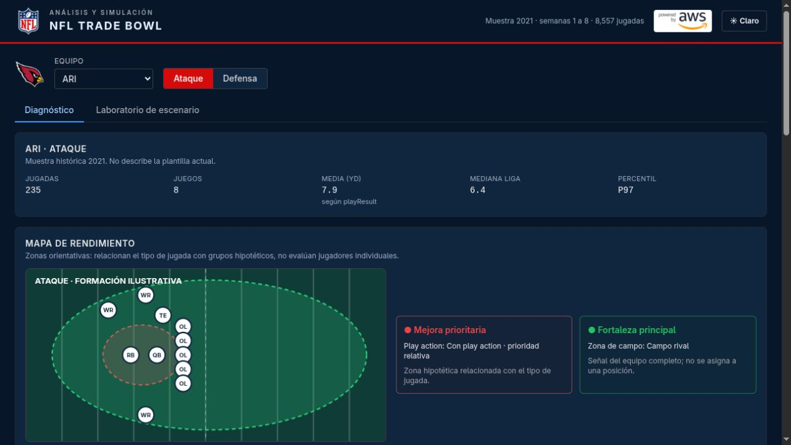

# NFL TRADE BOWL 🏈

### Del dato al tablero. Del tablero a una decisión.

¿Cómo puede un equipo encontrar oportunidades de mejora y explorar un intercambio cuando no dispone de toda la información del mercado? **NFL TRADE BOWL** convierte una muestra histórica de jugadas en un diagnóstico visual y un laboratorio interactivo de escenarios. Nuestro objetivo es que un analista pueda pasar de una tendencia observada a una conversación concreta sobre qué reforzar, qué ofrecer y con quién podría explorar un acuerdo.

> **Una demo para pensar, no una predicción de mercado.** Los resultados de rendimiento provienen de la muestra histórica; los jugadores, las plantillas, las selecciones y los intercambios del laboratorio son ficticios.

**Equipo Still-In:** Miguel Angel Jimenez y Angel Daniel Garcia · NFL Big Data Bowl UNAM



## Descubre, decide y simula

1. **Detecta oportunidades.** Elige un equipo y una perspectiva de ataque o defensa. El diagnóstico compara segmentos de jugadas de pase con la mediana de los equipos que tienen muestra suficiente. Cada comparación muestra su tamaño de muestra y un intervalo aproximado.
2. **Ubica las señales.** El mapa de rendimiento muestra en rojo la mejora prioritaria y en verde la fortaleza principal. Las zonas relacionan algunos tipos de jugada con grupos hipotéticos; la formación es ilustrativa y los colores no miden el rendimiento de jugadores individuales.
3. **Define tu estrategia.** Introduce un récord y elige competir ahora, competir y construir, o reconstruir. La aplicación muestra un reparto orientativo basado en el récord; no estima probabilidades reales de llegar al Super Bowl ni de obtener el primer pick.
4. **Construye un escenario.** Elige una necesidad, un área a reforzar y una posición. La app ordena a los otros 31 equipos por un índice de encaje simulado y explica brevemente qué podría ofrecer o recibir cada parte. Puedes abrir la evidencia histórica de cada socio.
5. **Interpreta la mezcla de resultados.** Las barras muestran la proporción de pases completos, incompletos, intercepciones, capturas y scrambles en la muestra del equipo. La marca vertical indica la mediana de los equipos; en defensa se observan los resultados del rival.
6. **Comparte tu idea.** Copia el resumen generado para discutirlo con tu equipo o integrarlo en la demo.

Si un equipo no presenta una diferencia adversa clara, se ofrece su segmento **menos favorable como prioridad relativa**. Esta opción permite explorar una mejora pequeña, incluso una selección ficticia de quinta o sexta ronda, sin afirmar que exista una debilidad demostrada ni asignarle un valor real.

## Cómo usar la aplicación

1. Abre la página y selecciona el **equipo** y la perspectiva **Ataque** o **Defensa**.
2. En **Diagnóstico**, revisa el mapa, las áreas de atención y las fortalezas. Usa **«Usar como necesidad»** en un hallazgo o en un segmento de la tabla para llevarlo al laboratorio. También puedes seleccionar un hallazgo directamente allí.
3. En **Laboratorio de escenario**, captura la temporada y el récord del equipo. Los porcentajes son una guía basada únicamente en ese récord; puedes escoger cualquiera de las tres estrategias.
4. Selecciona la necesidad y el área que deseas reforzar. Las posiciones muestran prioridades orientativas. Por ejemplo, para una hipótesis de ataque terrestre se presentan RB 75 %, OL 20 % y TE 5 %. El área terrestre se introduce manualmente: esta muestra no permite diagnosticar el juego terrestre.
5. Pulsa **«Generar escenario hipotético»**. Los socios se ordenan por tendencias adversas históricas y encaje entre plantillas simuladas. Despliega **«Ver evidencia histórica y límites»** para revisar el segmento comparado.
6. Usa el botón del encabezado para alternar entre **modo claro y oscuro**. Puedes copiar el resumen desde el resultado.

## Qué dicen —y qué no dicen— los datos

La aplicación lee `data/games.csv`, `data/plays.csv` y `data/players.csv`: una muestra de **8,557 jugadas de pase de 2021, semanas 1 a 8**, de 122 partidos. No representa todas las jugadas ni el estado actual de los equipos. `playResult` incluye yardas de penalización; las comparaciones son exploratorias y no demuestran causalidad. El tracking no se usa en esta versión.

No contamos con rosters actuales, contratos, salarios, agentes libres, valor de mercado, disponibilidad ni propiedad real de picks. Por eso, el laboratorio utiliza **plantillas y jugadores ficticios** y supone que cada equipo tiene una selección por ronda. Los porcentajes de posiciones y de encaje son reglas orientativas, no probabilidades ni valoraciones de mercado. La selección de una posición o un área no atribuye una debilidad histórica a un jugador.

## Ejecutar el proyecto

**Requisitos:** la plantilla oficial del hackatón ya instalada, con su entorno y los tres CSV anteriores dentro de `data/`. Los datos y las herramientas locales no se incluyen en Git.

Desde la raíz `hackathon-unam`, abre una terminal y ejecuta:

```bash
./iniciar.sh
```

Deja la terminal abierta y entra a **http://127.0.0.1:5173/**. El script inicia los servicios que falten. Para detener los que inició esa terminal, pulsa `Ctrl+C`.

También puedes iniciarlos por separado, usando dos terminales:

```bash
# Terminal 1: backend, desde la raíz
.venv/bin/uvicorn backend.main:app --reload
```

```bash
# Terminal 2: frontend
cd dashboard
PATH="../.hackathon/.tools/node/bin:$PATH" npm run dev
```

La aplicación usa la API real por defecto. Para iniciar el frontend con datos de ejemplo, usa `VITE_USE_MOCKS=true` antes de `npm run dev`. El entorno puede verificarse con `sh .hackathon/setup.sh --check`.

## Validación y entrega

```bash
# Desde la raíz: pruebas del backend
OPENBLAS_NUM_THREADS=1 .venv/bin/python -m pytest -q backend/tests

# Frontend: comprobación de tipos y compilación
cd dashboard
PATH="../.hackathon/.tools/node/bin:$PATH" npm run typecheck
PATH="../.hackathon/.tools/node/bin:$PATH" npm run build
```

Para preparar el ZIP del evento, desde la raíz ejecuta `sh .hackathon/setup.sh --entregar`. Revisa el archivo resultante y acompaña la entrega con el resultado visual o demo que soliciten los organizadores.

**Tecnología:** Python 3.12.12 · FastAPI · pandas · React 18 · Vite · TypeScript · Tailwind CSS · Recharts. Más contexto del dataset y de la API en `CONTEXTO_DATOS.md` y `docs/CONTRATO_API.md`.
